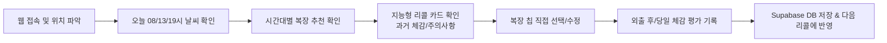

# Product Specification: Weather Outfit (날씨 기반 맞춤 복장 추천 및 체감 피드백 서비스)

## 1. 프로젝트 개요

### 1.1 목적 및 비전
기온 변화가 심한 환절기나 일교차가 큰 날씨에 외출 시 "오늘 뭘 입어야 할까?"라는 고민을 직관적이고 개인화된 방식으로 해결합니다.  
기상청 및 글로벌 기상 데이터(Open-Meteo)를 활용하여 표준 기온별 최적 복장을 제안하고, 사용자의 체감 만족도 피드백을 축적하여 기온 및 컨디션에 맞춘 **'지능형 복장 리콜(Intelligent Recall)'** 기능을 제공합니다.

### 1.2 핵심 가치 제안 (Value Propositions)
1. **정밀한 시간대별 기상 반영**: 하루 평균 기온이 아닌 출근(08시), 활동(13시), 퇴근/귀가(19시)의 특정 시간대별 기온과 체감온도를 기준으로 맞춤 제안.
2. **원클릭 위치 탐색**: 브라우저 위치 자동 감지 및 국내외 도시/지역명 검색 지원, 위치 실패 시 서울(기본) Fallback 보장.
3. **표준 8단계 룰셋 + 사용자 커스텀**: 공신력 있는 기온별 8단계 기본 추천에 더해, 사용자가 직접 상의·하의·외투·소품을 빠르게 커스터마이징 가능.
4. **개인화된 지능형 리콜 (기록 피드백 루프)**: 과거 기록 중 현재 기온(±2°C) 및 컨디션(감기, 피로 등)을 반영하여 "지난번에 이 기온에서 이 옷을 입었을 때 추웠음/딱 좋았음"을 미리 경고 및 추천.

---

## 2. 사용자 페르소나 및 핵심 시나리오

### 2.1 페르소나
- **김직장 (31세, 출퇴근 직장인)**: 아침 8시에 출근하여 밤 7시 이후 퇴근. 아침엔 쌀쌀하고 낮엔 덥고 밤엔 다시 쌀쌀하여 외투 챙김 여부를 매일 고민함.
- **이감기 (27세, 면역력 저하형 취준생/프리랜서)**: 감기 기운이 있거나 피곤할 때 다른 사람보다 추위를 2~3도 더 강하게 느껴 옷을 더 껴입어야 함.

### 2.2 사용자 핵심 여정 (User Journey)

---

## 3. 기능 요구사항 명세 (Functional Requirements)

### 3.1 위치 서비스 (Location Service)
| 기능 ID | 기능명 | 설명 | 예외 처리 |
| :--- | :--- | :--- | :--- |
| **FR-LOC-01** | 브라우저 위치 감지 | `navigator.geolocation` API를 활용하여 위도(latitude), 경도(longitude) 자동 획득 | 거부/지원안함 시 서울(37.5665, 126.9780) 기본 적용 |
| **FR-LOC-02** | 도시/지역명 검색 | Open-Meteo Geocoding API 연동 (`geocoding-api.open-meteo.com/v1/search`). 한글/영문 검색어 지원 및 자동완성 목록 제공 | 결과 없을 시 "검색 결과 없음" 인라인 안내 |
| **FR-LOC-03** | 위치 캐싱 | 마지막으로 성공적으로 조회한 위치(위도, 경도, 표시명)를 `localStorage`에 캐싱하여 재방문 시 즉시 렌더링 | 스토리지 에러 시 기본 서울 좌표 사용 |

### 3.2 날씨 데이터 서비스 (Weather Service)
| 기능 ID | 기능명 | 설명 | 비고 |
| :--- | :--- | :--- | :--- |
| **FR-WTH-01** | Open-Meteo Forecast | API Key 없이 `api.open-meteo.com/v1/forecast` 호출. 기온, 체감온도(apparent_temperature), 강수확률, 날씨 코드(WMO code) 수신 | 무료 엔드포인트 활용 |
| **FR-WTH-02** | 시간대별 타겟 예보 | 당일의 **08:00**, **13:00**, **19:00** 3개 기준 시간의 기온과 체감온도를 추출하여 탭 형태로 제공 | 가장 가까운 정시 데이터 매핑 |
| **FR-WTH-03** | 7일간의 주간 예보 | 오늘 포함 7일간의 일별 최고/최저 기온 및 날씨 아이콘(맑음, 흐림, 비, 눈 등)을 리스트/스크롤 형태로 표시 | 일간 기온 트렌드 파악 목적 |

### 3.3 8단계 표준 복장 추천 엔진 (Outfit Recommendation Engine)
한국 기상청 및 패션 커뮤니티에서 검증된 8단계 기온 표준 가이드를 룰셋으로 정의:

| 단계 | 기온 구간 | OUTER (외투) | TOP (상의) | BOTTOM (하의) | ITEM (소품/기타) |
| :---: | :--- | :--- | :--- | :--- | :--- |
| **1단계** | **28°C 이상** | 없음 | 민소매, 반팔 티셔츠, 린넨 셔츠 | 반바지, 린넨 팬츠, 얇은 치마 | 선글라스, 양산, 휴대용 선풍기 |
| **2단계** | **23°C ~ 27°C** | 얇은 셔츠(걸침용) | 반팔 티셔츠, 얇은 카라티, 블라우스 | 면바지, 청바지, 슬랙스 | 모자, 에코백 |
| **3단계** | **20°C ~ 22°C** | 얇은 가디건, 바람막이 | 롱슬리브, 셔츠, 칠부 티셔츠 | 슬랙스, 코튼 팬츠 | 시계, 가벼운 스니커즈 |
| **4단계** | **17°C ~ 19°C** | 가디건, 니트 조끼 | 맨투맨, 얇은 니트, 후드티 | 슬랙스, 데님 팬츠 | 머플러(선택) |
| **5단계** | **12°C ~ 16°C** | 자켓, 야상, 청자켓, 가죽자켓 | 니트, 맨투맨, 옥스포드 셔츠 | 기모 없는 청바지, 슬랙스 | 부츠, 로퍼 |
| **6단계** | **9°C ~ 11°C** | 트렌치코트, 점퍼, 울 자켓 | 도톰한 니트, 기모 후드티 | 기모바지, 청바지, 골덴 팬츠 | 보온 양말 |
| **7단계** | **5°C ~ 8°C** | 울 코트, 가죽 코트, 경량 패딩 | 기모 니트, 목폴라, 히트텍+셔츠 | 기모 슬랙스, 두꺼운 데님 | 장갑, 기모 스타킹 |
| **8단계** | **4°C 이하** | 롱패딩, 숏패딩, 두꺼운 코트 | 터틀넥, 히트텍(내의) 필수, 기모 맨투맨 | 방한 바지, 융기모 레깅스/데님 | 목도리, 장갑, 핫팩, 비니 |

- **동적 탭 바인딩**: 08시/13시/19시 탭 선택 시 해당 시간대의 기온(체감온도)에 해당하는 표준 조합이 자동으로 기본 선택됨.
- **아이템 커스텀 인터랙션**:
  - `OUTER`, `TOP`, `BOTTOM`: 각 카테고리당 1개만 선택 (Single-select chips) 또는 외투 '없음' 지원
  - `ITEM`: 여러 개 복수 선택 가능 (Multi-select chips)

### 3.4 체감 평가 및 피드백 로깅 (Feedback Logger)
오늘 착용한(또는 시뮬레이션한) 복장에 대해 체감 및 컨디션을 기록:
1. **체감 온도 편차 슬라이더 (-5°C ~ +5°C)**:
   - `-5°C`: 매우 추움 (보온 크게 부족, 극심한 추위)
   - `-4°C ~ -3°C`: 꽤 쌀쌀함 (보온 부족)
   - `-2°C ~ -1°C`: 약간 쌀쌀함
   - `0°C`: 적정 / 딱 맞음 (이상적 밸런스 ✨)
   - `+1°C ~ +2°C`: 약간 더움
   - `+3°C ~ +4°C`: 꽤 더움 (과보온)
   - `+5°C`: 매우 더움 (과보온, 땀 남)
2. **컨디션 라디오 버튼 (단일 선택)**:
   - `정상 (Normal)`: 보정치 0°C
   - `피곤 (Fatigued)`: 체감온도 -1.0°C 하향 보정
   - `감기 (Cold/Flu)`: 체감온도 -2.5°C 하향 보정
   - `활동량많음 (High Activity)`: 체감온도 +1.5°C 상향 보정
3. **간단 텍스트 메모**:
   - 착용 시의 특이사항 (예: "바람이 많이 불어 코트 단추를 잠금", "지하철이 너무 더웠음") 기록 (최대 100자).

### 3.5 지능형 리콜 시스템 (Intelligent Recall Engine)
- **과거 데이터 매칭 조건**: 현재 선택된 시간대의 기온을 $T_{curr}$이라 할 때, 과거 기록의 기온이 $[T_{curr} - 2.0^\circ\text{C}, T_{curr} + 2.0^\circ\text{C}]$ 범위에 드는 로그들을 조회.
- **컨디션 보정 계산**: 사용자의 현재 컨디션이 '감기'나 '피곤'인 경우, 가상 체감온도 $T_{eff} = T_{curr} - \Delta_{cond}$를 기준으로 검색 범위를 재산출하여 보온성이 더 높은 기록을 우선 탐색.
- **리콜 카드 3대 분류 표출**:
  1. 🌟 **추천 조합 (체감 0°C 적정, 편차 ±1°C 이내)**: "지난번 X월 X일 이 기온(16°C)에 입었을 때 체감이 딱 적정했습니다! (자켓 + 맨투맨)"
  2. ❄️ **추위 주의 (체감 -3°C ~ -5°C)**: "지난번에 이 복장을 입었을 때 체감이 -4°C로 매우 추웠습니다. 외투를 한 겹 더 챙기세요!"
  3. ☀️ **더위 주의 (체감 +3°C ~ +5°C)**: "지난번에 이 복장을 입었을 때 체감이 +4°C로 너무 더웠습니다. 가벼운 외투로 변경을 추천합니다."

---

## 4. 비기능적 요구사항 (Non-Functional Requirements)
1. **성능 & 로딩 속도**:
   - Open-Meteo API 호출 응답 캐싱(Next.js `revalidate: 1800`, 30분 단위 캐시)으로 빠른 TTFB 및 First Contentful Paint (< 1.2s) 보장.
2. **모바일 퍼스트 반응형 웹**:
   - 출근길 스마트폰(360px ~ 430px) 한 손 조작 최적화. 탭, 슬라이더, 칩 터치 영역 최소 44x44px 준수.
3. **안정성 & Fallback**:
   - GPS 권한 거부, 네트워크 오프라인, Open-Meteo 일시 장애 시에도 기본 서울 기온 및 표준 룰셋이 중단 없이 동작.
4. **접근성 (A11y)**:
   - WAI-ARIA 준수 (슬라이더 aria-valuenow/min/max, 라디오 그룹 레이블링, 고대비 텍스트).

---

## 5. 성공 지표 (KPI) & 향후 확장 로드맵
- **핵심 지표**: 일일 활성 사용자 수(DAU), 외출 전 복장 확인 후 피드백 작성 완료율(Feedback Completion Rate > 25%).
- **향후 확장 (Phase 2)**:
  - 개인 옷장(Digital Wardrobe) 사진 등록 및 옷장 내 보유 의류 기반 맞춤 추천.
  - 강수확률(POP)에 따른 우산 챙기기 알림 뱃지 자동 연동.
  - 소셜 로그인(Kakao/Google) 및 멀티 디바이스 동기화.
